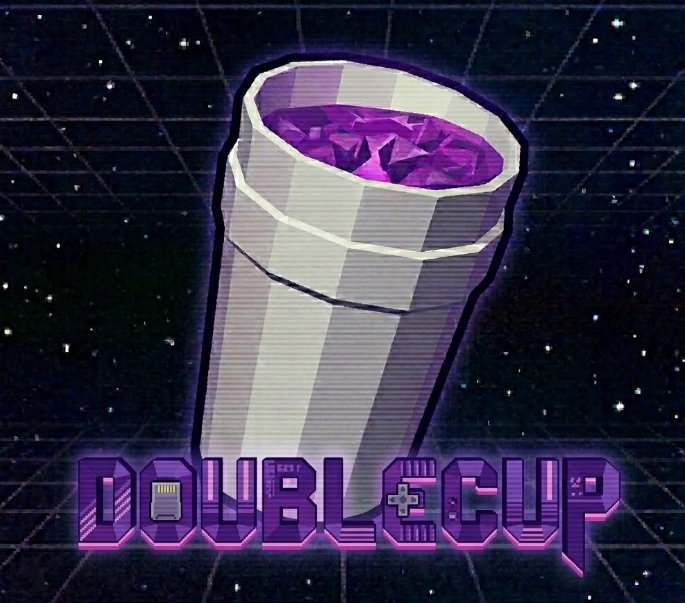
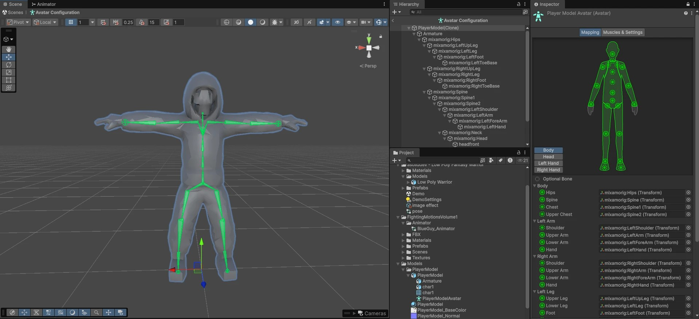
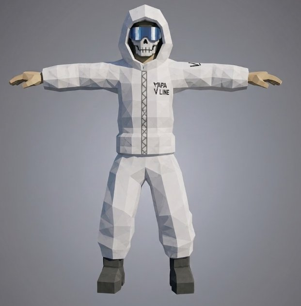
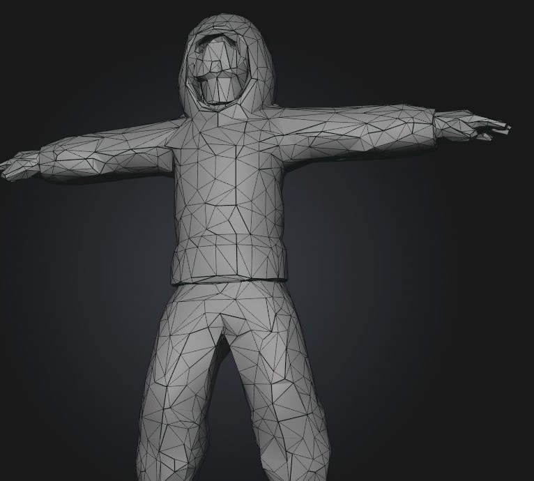
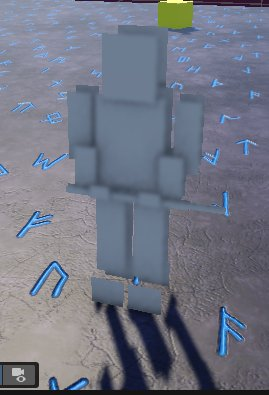

# DoubleCup Studios

### *Sombras Simplificadas. Abismos Profundos.*

**Estúdio indie brasileiro · Dark Fantasy Low Poly · Estreia na Steam em 2027**

---

## Bem-vindo ao abismo

A **DoubleCup Studios** nasceu em 2026, no Brasil, do encontro entre a precisão da Tecnologia da
Informação e uma paixão antiga por jogos. Somos um estúdio de **duas pessoas**: um desenvolvedor
que constrói o jogo sozinho (código, sistemas e gameplay) e um designer que dá forma aos
personagens e ao mundo.

Estamos criando uma **dark fantasy low poly**: formas simples, atmosfera densa e mecânicas sólidas.
Nosso primeiro título chega à **Steam em 2027**.

> *"Grandes mundos não precisam de milhões de triângulos, mas de uma atmosfera impecável e mecânicas sólidas."*
> **DoubleCup Studios**

## O que nos define

| ▲ Low Poly como Linguagem | ◆ Dark Fantasy Visceral | ⬡ Feito a Quatro Mãos |
|---|---|---|
| A estética poligonal não é limitação: é uma escolha narrativa. Cada triângulo existe para evocar o desconhecido. | Mundos densos, melancólicos e desafiadores, onde cada canto respira mistério. | Um dev vindo da TI e um designer com olhar para o estranho. Precisão técnica a serviço da arte. |

## Acompanhe o desenvolvimento

O jogo está em **desenvolvimento ativo**, e cada passo vai para o **Devlog** do site oficial:
notas de versão, progresso, artes e bastidores.

*Rig e animação de personagens em andamento.*
[Leia o post completo →](https://doublecup.vercel.app/devlog/character-rig-animation/)

## Por dentro da produção

## Faça parte da jornada

| | |
|---|---|
| 🌐 **Site oficial** | [doublecup.vercel.app](https://doublecup.vercel.app/) |
| 💬 **Discord** | [discord.gg/XQsXQTaBcH](https://discord.gg/XQsXQTaBcH) |
| 🎮 **Grupo Steam** | [steamcommunity.com/groups/DoubleCupStudios](https://steamcommunity.com/groups/DoubleCupStudios) |
| ⭐ **Curadoria Steam** | [store.steampowered.com/curator/46138982](https://store.steampowered.com/curator/46138982/) |
| ✉️ **Parcerias e contato** | contato@doublecup.net |

Seja para parcerias, imprensa, oportunidades ou só para acompanhar a jornada: estamos
construindo algo especial, e queremos você junto.

---

### 🇺🇸 In English

**DoubleCup Studios** is a two-person indie studio from **Brazil**, founded in 2026: one solo
developer building the game, one designer shaping its characters and world. We are crafting a
**low poly dark fantasy** (simple shapes, dense atmosphere, solid mechanics), with our first title
arriving on **Steam in 2027**.

Follow the devlog at **[doublecup.vercel.app](https://doublecup.vercel.app/)**, join our
**[Discord](https://discord.gg/XQsXQTaBcH)** and follow us on
**[Steam](https://store.steampowered.com/curator/46138982/)**.

---

© 2026 DoubleCup Studios · Brasil · Todos os direitos reservados

